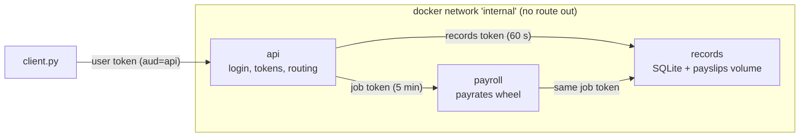

# Cleaning manager

Software Security, Assignment I (Aarhus University). A manager assigns jobs, cleaners clock in and out on their own jobs, and a cleaner generates a monthly payslip from their hours.

Protected: each cleaner's time entries, hourly rate and payslips.

| User      | Password       | Role               |
| --------- | -------------- | ------------------ |
| `iza`     | `iza-pass`     | cleaner, 180 DKK/h |
| `marius`  | `marius-pass`  | cleaner, 210 DKK/h |
| `andreea` | `andreea-pass` | manager            |

## Layout

- `api/`: the only public service (port 8000). Login, tokens, routing.
- `records/`: SQLite and payslip volume. Checks every token itself.
- `payroll/`: computes pay with the `payrates` wheel.
- `payrates/`: my helper package, built into `wheels/` and pinned by sha256 in `payroll/payrates.txt`.
- `tests/`: functional, authorization and exploit tests (`tests/exploits/`).
- `Jenkinsfile`, `jenkins/`: CI pipeline and the Jenkins image to run it.
- `evidence/`: pipeline output for `v1-vulnerable` and `v2-fixed`.
- `docs/`: [architecture](docs/ARCHITECTURE.md), [threat model](docs/THREAT_MODEL.md), [access control](docs/ACCESS_CONTROL.md), [vulnerabilities](docs/VULNERABILITIES.md), [plan](docs/PLAN.md), [decisions](docs/DECISIONS.md), [report](docs/REPORT.md).



## Build, seed, run, test

Needs docker with compose and Python 3.12+. Run from `Assignment_1/`.

```sh
python3 -m venv .venv && . .venv/bin/activate
pip install -r tests/requirements.txt   # requests for client.py, pytest for payrates

make build    # docker compose build
make up       # start api, records, payroll, wait until healthy
make seed     # reset the database to the seed data
make test     # payrates unit tests, then API tests in a container
make down     # stop and delete the volume
```

- Seed before testing. The tests expect the seed data.
- API tests run inside the compose network (`docker compose run --rm --build tests`) because some call `records`, which has no host port.
- After changing `payrates/`, run `payrates/build_wheel.sh`. It writes the wheel and its hash.
- Tags: `v1-vulnerable` has the four planted bugs, `v2-fixed` has the fixes.

## Example session

```text
$ python client.py login iza --password iza-pass
logged in as iza (cleaner)
$ python client.py search hans
[ { "id": 1, "customer": "Hansen", "address": "Nordre Ringgade 1, Aarhus C", "date": "2026-09-01", "cleaner": "iza" } ]
$ python client.py clock-in 1 --at 2026-09-12T08:00
{ "entry_id": 5 }
$ python client.py clock-out 1 --at 2026-09-12T11:30
{ "entry_id": 5, "start": "2026-09-12T08:00:00", "end": "2026-09-12T11:30:00" }
$ python client.py payslip 2026-09
{ "file": "iza-2026-09.csv", "hours": 11.0, "pay": 2610.0, "hourly_rate": 180.0 }
$ python client.py download iza-2026-09.csv
cleaner,iza
month,2026-09
hourly_rate,180.0

start,end,hours
2026-09-01T08:00:00,2026-09-01T12:00:00,4.0
2026-09-05T10:00:00,2026-09-05T13:30:00,3.5
2026-09-12T08:00:00,2026-09-12T11:30:00,3.5

total_hours,11.0
total_pay,2610.0
$ python client.py download ../marius/marius-2026-09.csv
error 404: no such payslip
$ python client.py all-hours
error 403: manager only
$ python client.py login andreea --password andreea-pass
logged in as andreea (manager)
$ python client.py all-hours
{ "hours": [ { "cleaner": "iza", "month": "2026-09", "hours": 11.0 },
             { "cleaner": "marius", "month": "2026-09", "hours": 10.0 } ],
  "payslips": [ "iza/iza-2026-09.csv" ] }
```

JSON compacted here. 5 and 12 September are Saturdays, so those shifts get the 50 % weekend supplement: 4 × 180 + 2 × (3.5 × 270) = 2610.

## Jenkins

Stages: ruff, bandit, pip-audit, wheel hash check, docker build, fresh `up` + seed, pytest. Artifacts: `bandit.json`, `pip-audit.json`, `junit*.xml`.

The build fails on:

- any bandit HIGH finding
- any pip-audit vulnerability with a fixed version
- any failing test, authorization tests included
- a wheel hash mismatch

Run it locally (`jenkins/Dockerfile` adds docker CLI, compose and python to `jenkins/jenkins:lts`):

```sh
docker build -t cleaning-jenkins Assignment_1/jenkins
docker run -d --name jenkins -p 8080:8080 \
  -v jenkins_home:/var/jenkins_home \
  -v /var/run/docker.sock:/var/run/docker.sock \
  --group-add "$(stat -c %g /var/run/docker.sock)" \
  --security-opt label=disable \
  cleaning-jenkins
docker exec jenkins cat /var/jenkins_home/secrets/initialAdminPassword
```

`--security-opt label=disable` is only for SELinux hosts like my Fedora box.

Then in http://localhost:8080:

1. Paste the password, install suggested plugins.
2. New Item, pick **Multibranch Pipeline**.
3. Branch Sources: GitHub, `https://github.com/mitmarcus/AU_SoftSec.git`. Keep "Discover branches" and "Discover pull requests from origin".
4. Script Path: `Assignment_1/Jenkinsfile`.
5. Scan Multibranch Pipeline Triggers: every 1 minute. Webhooks can't reach a laptop, so polling picks up pushes and PRs.
