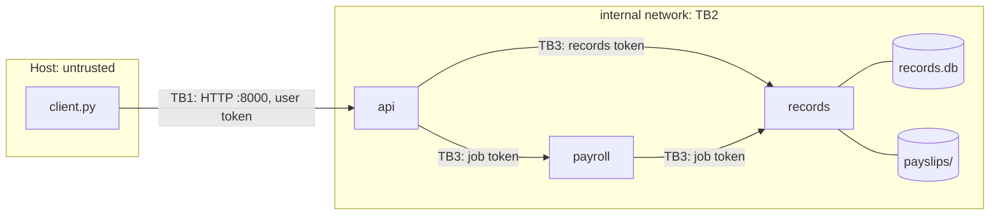
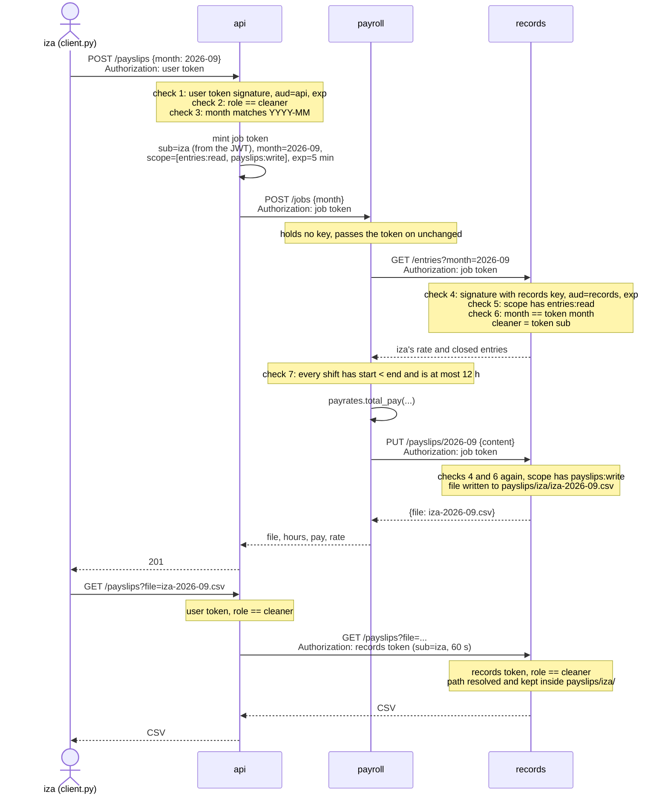

# Architecture

Three FastAPI services, one container each (`docker-compose.yml`), talking HTTP. The SQLite file lives inside `records` and isn't a component of its own.

| Component | Code | Owns | Holds | Network |
|---|---|---|---|---|
| `api` | `api/app.py` | nothing persistent | `API_JWT_KEY`, `RECORDS_JWT_KEY` | `public` (port 8000) and `internal` |
| `records` | `records/app.py` | users, jobs, entries (`/data/records.db`), payslip CSVs (`/data/payslips/<cleaner>/`) on volume `records-data` | `RECORDS_JWT_KEY` | `internal` only |
| `payroll` | `payroll/app.py` | nothing | no key, no volume | `internal` only |

- **Helper package:** `payrates` (`round_quarter`, `supplement`, `total_pay`). Built into `wheels/payrates-0.1.0-py3-none-any.whl` by `payrates/build_wheel.sh`, installed in `payroll/Dockerfile:9` with `pip install --no-deps --require-hashes -r payrates.txt`. Only the wheel goes into `payroll`, never the source.
- **Users:** every container runs as system user `app`.
- **Isolation:** `internal` is `internal: true` (`docker-compose.yml:44`), so `records` and `payroll` can't reach outside. Checked in Stage 2: a request from `payroll` to pypi.org failed with "Temporary failure in name resolution".

## Trust boundaries

- **TB1, host to `api`:** client input is untrusted. User token verified at `api/app.py:25`.
- **TB2, internal network:** being on it grants nothing. Before the CWE-862 fix (`9661bad`) `records` acted like it did. That was the composition bug.
- **TB3, service to service:** `records` decodes every token with its own key, `aud="records"`, required `exp`, `aud`, `sub` (`records/app.py:60-68`). Only `POST /login` skips this, and it just answers yes/no to a password.

## Tokens

| Token | Minted at | Claims | Key | Lifetime | Verified at |
|---|---|---|---|---|---|
| User token | `api/app.py:61` (login) | `sub`, `role`, `aud=api`, `exp` | `API_JWT_KEY` | 30 min | `api/app.py:25` |
| Records token | `api/app.py:40` (every user request) | `sub`, `role`, `aud=records`, `exp` | `RECORDS_JWT_KEY` | 60 s | `records/app.py:60` |
| Job token | `api/app.py:120` (payslip job) | `sub`, `job_id`, `month`, `scope=["entries:read","payslips:write"]`, `aud=records`, `exp` | `RECORDS_JWT_KEY` | 5 min | `records/app.py:60` and `:90` |

Records tokens have a `role` and no `scope`; job tokens the reverse. User endpoints require a role (`records/app.py:71`), job endpoints require a scope and matching month (`records/app.py:90`), so neither works on the other's endpoints (`test_job_token_cannot_use_user_endpoints`, `test_records_rejects_missing_scope`).

## Payslip flow

| Check | Code |
|---|---|
| 1 to 3 | `api/app.py:25`, `:121-123` |
| 4 | `records/app.py:60-68` |
| 5, 6 | `records/app.py:90-94` |
| 7 | `payroll/app.py:50-52` |
| download path | `records/app.py:235-239` |
