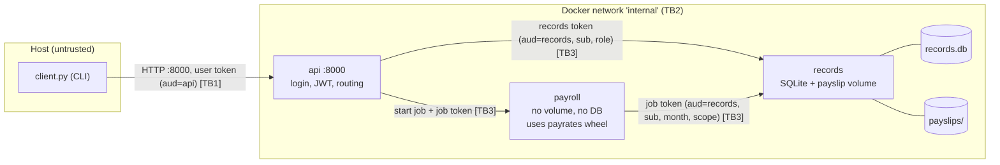

# Lifecycle plan

## 1. Purpose and scope

Small manager for a cleaning company. A manager assigns jobs, cleaners log hours on them, a cleaner generates a monthly payslip.

**Protected:** each cleaner's time entries, hourly rate and payslips.

| User      | Role    | Notes                                             |
| --------- | ------- | ------------------------------------------------- |
| `iza`     | cleaner | own hourly rate, entries for September 2026       |
| `marius`  | cleaner | different hourly rate, entries for September 2026 |
| `andreea` | manager | privileged role                                   |

**Features:**

1. Cleaner lists and searches own jobs; manager assigns jobs. (`api` to `records`)
2. Cleaner clocks in/out on own jobs. (`api` to `records`)
3. Cleaner generates and downloads own payslip. (`api` to `payroll` to `records`, uses all three)
4. Manager lists everyone's hours and payslips. (`api` to `records`)

### Functional requirements

- FR1 Username/password login returns a JWT.
- FR2 Cleaners see only their jobs; managers assign jobs to anyone.
- FR3 Cleaners clock in/out only on their own jobs.
- FR4 Cleaners generate payslips from their own entries and download only their own.
- FR5 Only managers list all hours and payslips.
- FR6 Pay comes from my `payrates` package (quarter-hour rounding, evening/weekend supplement, total).

### Non-functional requirements

- NFR1 Three containers, HTTP over an internal docker network, only `api` published.
- NFR2 `records` authorises every request, whoever sent it.
- NFR3 bcrypt passwords; PyJWT HS256, one key per audience.
- NFR4 Exact version pins; `payrates` wheel installed with `--require-hashes`.
- NFR5 Non-root containers.
- NFR6 One command to build and start; tear down and recreate for tests.

## 2. Architecture and data flow

- **TB1, host to `api`:** only published port, client input untrusted.
- **TB2, internal network.**
- **TB3, service to service:** `records` verifies a token on every call. Network position and headers other than `Authorization` mean nothing.

| Token         | Minted by              | Claims                                                                                    | Key               | Lifetime | Checked by |
| ------------- | ---------------------- | ----------------------------------------------------------------------------------------- | ----------------- | -------- | ---------- |
| User token    | `api` at login         | `sub`, `role`, `exp`, `aud=api`                                                           | `API_JWT_KEY`     | 30 min   | `api`      |
| Records token | `api` per user request | `sub`, `role`, `exp`, `aud=records`                                                       | `RECORDS_JWT_KEY` | 60 s     | `records`  |
| Job token     | `api` per payslip job  | `sub`, `job_id`, `month`, `scope=["entries:read","payslips:write"]`, `exp`, `aud=records` | `RECORDS_JWT_KEY` | 5 min    | `records`  |

`payroll` has no key, so it can carry a job token but not mint or change one. Binding: service by `aud`, resource by `sub` + `month`, action by `scope`, time by `exp`.

## 3. Asset register

| No. | Asset                    | Description / Purpose                                | Security Importance                                                                     |
| --- | ------------------------ | ---------------------------------------------------- | --------------------------------------------------------------------------------------- |
| 1   | Time entries             | Clock-in/out per cleaner and job; input to pay       | Integrity: wrong entries, wrong pay. Confidentiality: where and when someone works      |
| 2   | Payslips (CSV files)     | Hours and pay per cleaner per month                  | Confidentiality: salary. Integrity: basis for payment                                   |
| 3   | Hourly rates             | Per cleaner in `records`                             | Confidential between cleaners                                                           |
| 4   | Jobs                     | Customer name, address, assigned cleaner             | Customer data confidentiality; assignment integrity                                     |
| 5   | Credentials and JWT keys | bcrypt hashes, `API_JWT_KEY`, `RECORDS_JWT_KEY`      | A leaked key mints any token                                                            |
| 6   | `payrates` wheel         | Computes pay                                         | Integrity: runs inside `payroll` next to the job token                                  |

## 4. STRIDE threat model

| STRIDE                 | Threat                                                                                                          | Asset   | Impact                                                           |
| ---------------------- | --------------------------------------------------------------------------------------------------------------- | ------- | ---------------------------------------------------------------- |
| Spoofing               | Forged or expired token, or an internal request claiming another cleaner (`X-Cleaner-Id`)                       | 1, 2, 3 | Read/write another cleaner's data                                |
| Tampering              | Shift ending before it starts, or 30 h long                                                                     | 1, 2    | Inflated pay                                                     |
| Tampering              | Search input changes the SQL                                                                                    | 4, 1    | Other cleaners' jobs exposed                                     |
| Tampering              | Swapped `payrates` wheel computes wrong pay or exfiltrates                                                      | 2, 6    | Wrong or leaked payslips                                         |
| Repudiation            | Cleaner denies registering an entry                                                                             | 1       | Pay dispute; only the creating `sub` is stored                   |
| Information Disclosure | `../` in payslip filename                                                                                       | 2, 3    | Salary and hours leaked                                          |
| Information Disclosure | Cleaner calls manager overview                                                                                  | 1, 2    | All salaries leaked                                              |
| Denial of Service      | Payslip job flood                                                                                               | 2       | Slow service; out of scope (no rate limiting)                    |
| Elevation of Privilege | Cleaner token on manager endpoints, or `payroll` acting outside its job                                         | 1, 2, 4 | Manager actions by a cleaner; cross-cleaner writes               |

| STRIDE                 | Primary control                                                                                 | Objective       |
| ---------------------- | ----------------------------------------------------------------------------------------------- | --------------- |
| Spoofing               | bcrypt login, signed JWT with `aud` and `exp`, identity only from verified claims               | Authentication  |
| Tampering              | Parameterised SQL; time-entry validation in `records` and `payroll`; pinned wheel hash          | Integrity       |
| Repudiation            | Entries store the creating token's `sub`                                                        | Accountability  |
| Information Disclosure | Ownership check on every `records` query; canonical payslip paths                               | Confidentiality |
| Denial of Service      | Short token lifetimes only                                                                      | Availability    |
| Elevation of Privilege | Role check in `api` and `records`; job token = one cleaner, one month                           | Authorization   |

## 5. Access-control matrix

"own" = resource's cleaner equals token `sub`. Anything not listed is denied.

| Operation                | Endpoint (component)                                      | anonymous | cleaner        | manager | payroll (job token)                                |
| ------------------------ | --------------------------------------------------------- | --------- | -------------- | ------- | -------------------------------------------------- |
| Log in                   | `POST /login` (api)                                       | yes       | yes            | yes     | no                                                 |
| List jobs                | `GET /jobs` (api to records)                              | no        | own            | all     | no                                                 |
| Search jobs by customer  | `GET /jobs/search` (api to records)                       | no        | own            | all     | no                                                 |
| Assign job               | `POST /jobs` (api to records)                             | no        | no             | yes     | no                                                 |
| Clock in / out           | `POST /jobs/{id}/clock-in`, `/clock-out` (api to records) | no        | own job        | no      | no                                                 |
| Start payslip job        | `POST /payslips` (api to payroll)                         | no        | own, one month | no      | no                                                 |
| Read entries for a month | `GET /entries` (records)                                  | no        | no             | no      | `sub` and `month` of token, scope `entries:read`   |
| Write payslip            | `PUT /payslips/{month}` (records)                         | no        | no             | no      | `sub` and `month` of token, scope `payslips:write` |
| Download payslip         | `GET /payslips/{file}` (api to records)                   | no        | own            | no      | no                                                 |
| All hours and payslips   | `GET /manager/overview` (api to records)                  | no        | no             | yes     | no                                                 |

## 6. Asset to gate chain

| Asset                  | Threat                                           | Control                                                                       | Activity                 | Evidence                           | Gate                                |
| ---------------------- | ------------------------------------------------ | ----------------------------------------------------------------------------- | ------------------------ | ---------------------------------- | ----------------------------------- |
| Time entries           | Cleaner reads or edits another's entries         | Ownership check in `records` from token `sub`                                 | Implementation           | cross-cleaner tests in `tests/`    | Any failing authz test blocks       |
| Time entries           | Impossible shifts inflate pay                    | end > start, shift ≤ 12 h, month format, in `records` and `payroll`           | Implementation, testing  | CWE-20 exploit test                | Blocks                              |
| Payslips               | Path traversal to another cleaner's file         | `Path.resolve()` + `is_relative_to`                                           | Implementation, testing  | CWE-22 exploit test                | Blocks                              |
| Payslips               | Confused deputy via `X-Cleaner-Id`               | Cleaner from the JWT only; `records` authorises only from the job token       | Design review, testing   | composition exploit test           | Blocks                              |
| Jobs                   | SQL injection in search                          | Parameterised query                                                           | Static analysis, testing | `bandit.json`, CWE-89 exploit test | bandit HIGH blocks                  |
| JWT keys               | Token replayed at another service                | One key per audience, `aud` checked                                           | Implementation           | wrong-audience test                | Blocks                              |
| Hourly rates, payslips | Cleaner calls manager endpoints                  | Role check in `api` and `records`                                             | Testing                  | cleaner-calls-manager test         | Blocks                              |
| `payrates` wheel       | Unapproved or changed artifact                   | `pip install --require-hashes`                                                | Build                    | wheel hash check stage             | Mismatch blocks                     |
| All                    | Known-vulnerable dependency                      | Exact pins, `pip-audit`                                                       | Build                    | `pip-audit.json`                   | Finding with a fixed version blocks |

## 7. SSDLC phases

| Phase                         | Deliverable                                                                                           | Gate                                                                                                          |
| ----------------------------- | ----------------------------------------------------------------------------------------------------- | ------------------------------------------------------------------------------------------------------------- |
| Requirements                  | This file: scope, assets, trust boundaries, access matrix, STRIDE                                     | My review: architecture fits scope, every operation has an authority, every STRIDE row has a control          |
| Implementation and build      | Three containers, pinned `requirements.txt` each, hashed `payrates` wheel                             | Fails on an unlisted dependency or wheel hash mismatch                                                        |
| Testing                       | Functional, authorization, exploit tests; bandit and pip-audit reports                                | Fails on bandit HIGH, fixable pip-audit finding, failing authz test, or hash mismatch                         |
| Release, deploy and operation | In the report: secrets management, TLS, key rotation, logging and monitoring, signed artifacts        | None here                                                                                                     |

## 8. Design principles

| Principle          | Decision                                                                                          | Where                                                | Evidence                                                                        |
| ------------------ | ------------------------------------------------------------------------------------------------- | ---------------------------------------------------- | ------------------------------------------------------------------------------- |
| Least privilege    | `payroll`: no key, volume or DB; job token = one cleaner, one month, two scopes, 5 min            | `docker-compose.yml`, job-token minting in `api`     | `payroll` can't write a payslip for another cleaner or month                    |
| Complete mediation | `records` checks token, role, ownership on every request, from `api` and `payroll` alike          | one auth dependency in `records` used by every route | expired, wrong-audience, missing-scope token tests; cross-cleaner tests         |
| Fail-safe defaults | Missing/invalid token, unknown role or unlisted operation gets 401/403                           | auth helpers in `api` and `records`                  | cleaner-calls-manager test, missing-token test                                  |

## 9. Planned vulnerabilities

All four **on purpose**. Each in its own commit with `# VULN CWE-xx`, an exploit test, tagged `v1-vulnerable`, then fixed and tagged `v2-fixed`.

| #   | CWE                                       | Where                                                                                                                       | Attack                                           |
| --- | ----------------------------------------- | --------------------------------------------------------------------------------------------------------------------------- | ------------------------------------------------ |
| V1  | CWE-22 Path Traversal                     | `records` payslip download joins the filename onto the folder without canonicalising                                        | `iza` downloads `../marius/marius-2026-09.csv`   |
| V2  | CWE-89 SQL Injection                      | `records` job search builds `LIKE` with an f-string                                                                         | `' OR 1=1 --` returns all jobs                   |
| V3  | CWE-20 Improper Input Validation          | `records` clock-out accepts end < start or 30 h shifts; `payroll` assumes entries are valid                                 | `iza` pads own pay                               |
| V4  | CWE-862 across services (confused deputy) | `api` takes `cleaner_id` from the body; `payroll` forwards it as `X-Cleaner-Id`; `records` trusts it from the internal network | `iza` generates and downloads `marius`'s payslip |

## Changes during development

Sections 1 to 9 are the plan from `65be63d`, committed before feature code. Reworded since, same content. Below: where the code differs, and how the gates went.

### Design and interfaces

- **Download:** `GET /payslips?file=<name>`, not `/payslips/{file}`. HTTP clients strip `../` from paths, which would hide CWE-22.
- **Overview:** `GET /manager/overview` on `api`, `GET /overview` on `records`.
- **Login:** `records` `POST /login` takes no token. It answers yes/no; `api` mints the token.
- **Wheel hash:** in `payroll/payrates.txt`, not `requirements.txt`. One hashed line makes pip want hashes everywhere, so separate `--require-hashes --no-deps` step (`payroll/Dockerfile:9`).
- **Payroll response:** includes `hourly_rate` (added with V4, `baed1bb`).
- **Tests:** run in a `tests` container on `internal` to reach `records`. Stage 5 switched from mounting to copying them in, since bind mounts break when Jenkins runs in a container (`e2eeee0`).
- **CI support:** healthchecks, `up --wait`, configurable `API_PORT` (CI uses 18000) in `e2eeee0`. `jenkins/Dockerfile` adds docker CLI, compose, Python to `jenkins/jenkins:lts`.
- **V4 leak path:** marius's data reaches iza in the `POST /payslips` response. The download uses iza's own records token, so it doesn't work there.
- **Skipped:** optional supply-chain attack, Experiments A and B.

### Gate decisions

| Gate | Decision | Evidence |
|---|---|---|
| Requirements | Passed after my review. Architecture and roles unchanged since | `65be63d` |
| Implementation and build | Passed. All deps pinned, hash check passes. A wheel with one extra byte is refused by the `payroll/Dockerfile` install step | "Wheel hash check" in `evidence/v2-fixed/pipeline.log`; `evidence/wheel-tamper.log` ("THESE PACKAGES DO NOT MATCH THE HASHES") |
| Testing, `v1-vulnerable` | **Blocked.** `test_payroll_cannot_act_for_other_cleaner`, `test_api_ignores_cleaner_in_payslip_request` failed | `evidence/v1-vulnerable/pipeline.log`, "2 failed, 23 passed", "Finished: FAILURE" |
| Testing, `v2-fixed` | Passed: 25 + 3 tests, no bandit HIGH, no fixable pip-audit finding | `evidence/v2-fixed/pipeline.log`, "Finished: SUCCESS" |

What the gates taught me:

- **Bandit missed the SQLi.** B608 is MEDIUM/LOW confidence, under my HIGH gate. I kept the gate; the failing authz tests blocked `v1-vulnerable` instead. Finding is in `evidence/v1-vulnerable/bandit.json`.
- **Tag placement.** `v1-vulnerable` is on `305067f` (Jenkinsfile commit), not the V4 commit `baed1bb`, so the pipeline can run on it. No vulnerability changed in between.
- **ruff 0.17** lints more rules by default than what I started with. Added `ruff.toml` to allow FastAPI `Depends()` defaults (B008), fixed the rest (`ff7cd36`).
