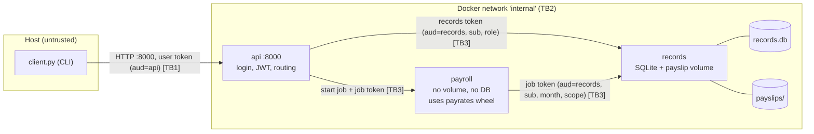

# Lifecycle plan

## 1. Purpose and scope

The system is a small manager for a cleaning company. A manager assigns cleaning jobs to cleaners, cleaners register their hours on those jobs, and a cleaner can generate a payslip for a month.

Protected resources: a cleaner's time entries, their hourly rate and their payslips.

Users:

| User      | Role    | Notes                                             |
| --------- | ------- | ------------------------------------------------- |
| `iza`     | cleaner | own hourly rate, entries for September 2026       |
| `marius`  | cleaner | different hourly rate, entries for September 2026 |
| `andreea` | manager | privileged role                                   |

Functionalities:

1. Cleaner lists their assigned jobs and searches them by customer name; manager assigns a job to a cleaner. (`api` to `records`)
2. Cleaner clocks in and out on one of their own jobs. (`api` to `records`)
3. Cleaner generates and downloads their payslip for a month. (`api` to `payroll` to `records`; uses all three components)
4. Manager lists all cleaners' hours and payslips. (`api` to `records`)

### Functional requirements

- FR1 Users log in with username and password and receive a JWT.
- FR2 A cleaner sees only jobs assigned to them; a manager can assign a job to any cleaner.
- FR3 A cleaner can clock in and out only on their own jobs.
- FR4 A cleaner can generate a payslip for a month from their own entries and download only their own payslips.
- FR5 Only a manager can list all cleaners' hours and payslips.
- FR6 Pay is computed by the helper package `payrates` (quarter-hour rounding, evening/weekend supplement, total).

### Non-functional requirements

- NFR1 Three components in separate containers, talking HTTP over an internal docker network; only `api` is published to the host.
- NFR2 Every request to `records` is authorised there, whatever component sent it.
- NFR3 Passwords stored with bcrypt; tokens are PyJWT HS256 with one key per audience.
- NFR4 Every dependency pinned to an exact version; the `payrates` wheel installed with `--require-hashes`.
- NFR5 Containers run as non-root;
- NFR6 The stack builds and starts with one command and can be torn down and recreated for tests.

## 2. Architecture and data flow

Trust boundaries:

- **TB1** host to `api`: the only published port. Everything from the client is untrusted.
- **TB2** the internal docker network.
- **TB3** each service-to-service call. `records` verifies a token on every call; it does not trust the caller's network position or any header other than `Authorization`.

Tokens:

| Token         | Minted by              | Claims                                                                                    | Key               | Lifetime | Checked by |
| ------------- | ---------------------- | ----------------------------------------------------------------------------------------- | ----------------- | -------- | ---------- |
| User token    | `api` at login         | `sub`, `role`, `exp`, `aud=api`                                                           | `API_JWT_KEY`     | 30 min   | `api`      |
| Records token | `api` per user request | `sub`, `role`, `exp`, `aud=records`                                                       | `RECORDS_JWT_KEY` | 60 s     | `records`  |
| Job token     | `api` per payslip job  | `sub`, `job_id`, `month`, `scope=["entries:read","payslips:write"]`, `exp`, `aud=records` | `RECORDS_JWT_KEY` | 5 min    | `records`  |

`payroll` holds no key. It carries the job token it was given and cannot mint or change one. Authority is bound to the service by `aud`, to the resource by `sub` and `month`, to the action by `scope`, and to the validity period by `exp`.

## 3. Asset register

| No. | Asset                    | Description / Purpose                                | Security Importance                                                                           |
| --- | ------------------------ | ---------------------------------------------------- | --------------------------------------------------------------------------------------------- |
| 1   | Time entries             | Clock-in/out times per cleaner and job; input to pay | Integrity: wrong entries mean wrong pay. Confidentiality: shows where a person works and when |
| 2   | Payslips (CSV files)     | Hours and pay per cleaner per month                  | Confidentiality: salary data. Integrity: basis for payment                                    |
| 3   | Hourly rates             | Stored per cleaner in `records`                      | Confidentiality between cleaners                                                              |
| 4   | Jobs                     | Customer name, address, assigned cleaner             | Confidentiality of customer data; integrity of assignments                                    |
| 5   | Credentials and JWT keys | bcrypt hashes, `API_JWT_KEY`, `RECORDS_JWT_KEY`      | A leaked key lets an attacker mint any token                                                  |
| 6   | `payrates` wheel         | Helper package that computes pay                     | Integrity: it runs inside `payroll` next to the job token                                     |

## 4. STRIDE threat model

| STRIDE Category        | Threat / Attack Scenario                                                                                                | Affected Asset | Impact                                                                 |
| ---------------------- | ----------------------------------------------------------------------------------------------------------------------- | -------------- | ---------------------------------------------------------------------- |
| Spoofing               | A cleaner sends a forged or expired token, or a request from inside the network claims another cleaner (`X-Cleaner-Id`) | 1, 2, 3        | Reads or writes another cleaner's data                                 |
| Tampering              | A cleaner registers a shift that ends before it starts or lasts 30 hours                                                | 1, 2           | Inflated pay                                                           |
| Tampering              | Customer search input changes the SQL query                                                                             | 4, 1           | Other cleaners' jobs exposed                                           |
| Tampering              | Swapped `payrates` wheel computes wrong pay or exfiltrates data                                                         | 2, 6           | Wrong or leaked payslips                                               |
| Repudiation            | A cleaner denies registering an entry                                                                                   | 1              | Pay dispute; handled only by storing the `sub` that created each entry |
| Information Disclosure | `../` in a payslip filename reads another cleaner's payslip                                                             | 2, 3           | Salary and hours leaked                                                |
| Information Disclosure | Cleaner calls the manager overview                                                                                      | 1, 2           | All salaries leaked                                                    |
| Denial of Service      | Flood of payslip jobs                                                                                                   | 2              | Slow service; out of scope (no rate limiting)                          |
| Elevation of Privilege | Cleaner token used on manager endpoints, or `payroll` acts outside its job                                              | 1, 2, 4        | Manager actions by a cleaner; cross-cleaner writes                     |

### Threat to security control mapping

| Threat / STRIDE Category | Primary Security Control                                                                        | Security Objective |
| ------------------------ | ----------------------------------------------------------------------------------------------- | ------------------ |
| Spoofing                 | bcrypt login, signed JWT with `aud` and `exp`, identity only from verified token claims         | Authentication     |
| Tampering                | Parameterised SQL; time-entry validation in `records` and again in `payroll`; wheel hash pinned | Integrity          |
| Repudiation              | Entries store the `sub` from the token that created them                                        | Accountability     |
| Information Disclosure   | Ownership check on every `records` query; canonicalised payslip paths                           | Confidentiality    |
| Denial of Service        | Short token lifetimes; nothing further                                                          | Availability       |
| Elevation of Privilege   | Role check in `api` and again in `records`; job token limited to one cleaner and one month      | Authorization      |

## 5. Access-control matrix

Rows are operations, columns are callers. "own" means the resource's cleaner equals the token's `sub`.

| Operation                | Endpoint (component)                                      | anonymous | cleaner        | manager | payroll (job token)                                |
| ------------------------ | --------------------------------------------------------- | --------- | -------------- | ------- | -------------------------------------------------- |
| Log in                   | `POST /login` (api)                                       | yes       | yes            | yes     | no                                                 |
| List jobs                | `GET /jobs` (api to records)                              | no        | own            | all     | no                                                 |
| Search jobs by customer  | `GET /jobs/search` (api to records)                       | no        | own            | all     | no                                                 |
| Assign job               | `POST /jobs` (api to records)                             | no        | no             | yes     | no                                                 |
| Clock in / out           | `POST /jobs/{id}/clock-in`, `/clock-out` (api to records) | no        | own job        | no      | no                                                 |
| Start payslip job        | `POST /payslips` (api to payroll)                         | no        | own, one month | no      | no                                                 |
| Read entries for a month | `GET /entries` (records)                                  | no        | no             | no      | `sub` and `month` of token, scope `entries:read`   |
| Write payslip            | `PUT /payslips/{month}` (records)                         | no        | no             | no      | `sub` and `month` of token, scope `payslips:write` |
| Download payslip         | `GET /payslips/{file}` (api to records)                   | no        | own            | no      | no                                                 |
| All hours and payslips   | `GET /manager/overview` (api to records)                  | no        | no             | yes     | no                                                 |

Anything not listed is denied.

## 6. Asset to gate chain

| Asset                  | Threat                                           | Requirement / control                                                         | Lifecycle activity       | Test / evidence                    | Gate decision                       |
| ---------------------- | ------------------------------------------------ | ----------------------------------------------------------------------------- | ------------------------ | ---------------------------------- | ----------------------------------- |
| Time entries           | Cleaner reads or edits another cleaner's entries | Ownership check in `records` from token `sub`                                 | Implementation           | cross-cleaner tests in `tests/`    | Any failing authz test blocks       |
| Time entries           | Impossible shifts inflate pay                    | Validate end > start, shift ≤ 12 h, month format, in `records` and `payroll`  | Implementation, testing  | CWE-20 exploit test                | Blocks                              |
| Payslips               | Path traversal to another cleaner's file         | `Path.resolve()` + `is_relative_to`                                           | Implementation, testing  | CWE-22 exploit test                | Blocks                              |
| Payslips               | Confused deputy via `X-Cleaner-Id`               | Cleaner taken from the JWT only; `records` authorises only from the job token | Design review, testing   | composition exploit test           | Blocks                              |
| Jobs                   | SQL injection in search                          | Parameterised query                                                           | Static analysis, testing | `bandit.json`, CWE-89 exploit test | bandit HIGH blocks                  |
| JWT keys               | Token for one service replayed at another        | One key per audience, `aud` checked                                           | Implementation           | wrong-audience test                | Blocks                              |
| Hourly rates, payslips | Cleaner calls manager endpoints                  | Role check in `api` and `records`                                             | Testing                  | cleaner-calls-manager test         | Blocks                              |
| `payrates` wheel       | Unapproved or changed artifact                   | `pip install --require-hashes`                                                | Build                    | wheel hash check stage             | Mismatch blocks                     |
| All                    | Known-vulnerable dependency                      | Exact pins, `pip-audit`                                                       | Build                    | `pip-audit.json`                   | Finding with a fixed version blocks |

## 7. SSDLC phases

| Phase                         | Deliverable                                                                                                                | Gate                                                                                                                                    |
| ----------------------------- | -------------------------------------------------------------------------------------------------------------------------- | --------------------------------------------------------------------------------------------------------------------------------------- |
| Requirements                  | This file: scope and operations, asset register, trust boundaries, access-control matrix, STRIDE                           | I review that the architecture meets the scope, every operation has a defined authority, and each STRIDE row has a control              |
| Implementation and build      | Three containers, pinned `requirements.txt` per service, `payrates` wheel with its hash                                    | Build fails on an unlisted dependency or a wheel hash mismatch                                                                          |
| Testing                       | Functional, authorization and exploit tests; bandit and pip-audit reports                                                  | Pipeline fails on any bandit HIGH, any pip-audit finding with a fixed version, any failing authorization test, or a wheel hash mismatch |
| Release, deploy and operation | Discussion in the report: secrets management, TLS between services, key rotation, logging and monitoring, signed artifacts | None in this project                                                                                                                    |

## 8. Design principles

| Principle          | Decision                                                                                                                  | Where it will appear                                 | Evidence                                                                        |
| ------------------ | ------------------------------------------------------------------------------------------------------------------------- | ---------------------------------------------------- | ------------------------------------------------------------------------------- |
| Least privilege    | `payroll` has no key, no volume and no database; its job token covers one cleaner, one month and two scopes for 5 minutes | `docker-compose.yml`, job-token minting in `api`     | test that `payroll` cannot write a payslip for another cleaner or month         |
| Complete mediation | `records` checks token, role and ownership on every request, including those from `api` and `payroll`                     | one auth dependency in `records` used by every route | tests for expired, wrong-audience and missing-scope tokens; cross-cleaner tests |
| Fail-safe defaults | Missing or invalid token, unknown role or unlisted operation returns 401/403; nothing is allowed unless a rule allows it  | auth helpers in `api` and `records`                  | cleaner-calls-manager test, missing-token test                                  |

## 9. Planned vulnerabilities

All four are **planned**. Each is added in its own commit with a `# VULN CWE-xx` comment, shown with an exploit test, tagged `v1-vulnerable`, then fixed and tagged `v2-fixed`.

| #   | CWE                                       | Where                                                                                                                                           | Attack                                           |
| --- | ----------------------------------------- | ----------------------------------------------------------------------------------------------------------------------------------------------- | ------------------------------------------------ |
| V1  | CWE-22 Path Traversal                     | `records` payslip download joins the filename onto the cleaner's payslip folder without canonicalising it                                       | `iza` downloads `../marius/marius-2026-09.csv`   |
| V2  | CWE-89 SQL Injection                      | `records` job search builds the `LIKE` query with an f-string                                                                                   | `' OR 1=1 --` returns all cleaners' jobs         |
| V3  | CWE-20 Improper Input Validation          | `records` clock-out accepts an end before the start or a 30-hour shift; `payroll` assumes the entries are valid                                 | `iza` inflates her own pay                       |
| V4  | CWE-862 across services (confused deputy) | `api` takes `cleaner_id` from the request body; `payroll` forwards it as `X-Cleaner-Id`; `records` trusts that header from the internal network | `iza` generates and downloads `marius`'s payslip |

## Changes during development

(Appended in Stage 8.)
